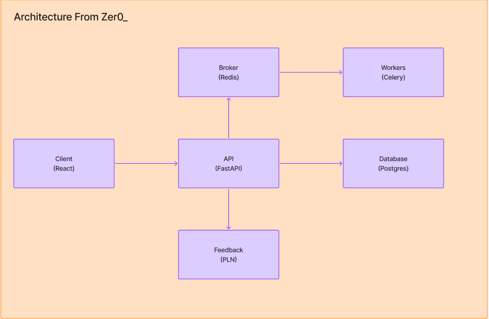

# 🤖 Sidebrain - Seu mentor para aprendizado de habilidades com IA

  

## Índice

- [📝 Descrição do Projeto](#-descrição-do-projeto)
- [📋 Product Backlog](#-product-backlog)
- [📅 Cronograma](#-cronograma)
- [🏗️ Estrutura do Projeto e Arquitetura](#️-estrutura-do-projeto-e-arquitetura)
- [⚙️ Tecnologias Utilizadas](#️-tecnologias-utilizadas)
- [📂 Documentação](#-documentação)
- [👥 Equipe](#-equipe)

---

## 📝 Descrição do Projeto
Aprender ou desenvolver uma nova habilidade exige mais do que apenas acesso a conteúdo, muitas pessoas não sabem por onde começar e nem como começar. Em casos como estudo para vestibular, redação, idiomas, desenvolvimento pessoal etc, é comum que as pessoas tenham dificuldades em identificar em que nível estão ou a definir objetivos claros e perceber se estão realmente evoluindo.

O **Sidebrain** surge dessa necessidade. Utilizando processamento de linguagem natural e Inteligência Artificial para atuar como um mentor virtual, propondo atividades personalizadas, acompanhando o progresso do usuário e oferecendo feedback de forma inteligente, gamificada e engajadora.

---

## 📋 Product Backlog

| ID | User Story | Prioridade | Sprint | Requisito |
|----|-------------|:----------:|:------:|:---------:|
| US01 | Como sistema, desejo manter uma memória resumida da aprendizagem e utilizar estratégias de redução de contexto, para personalizar as interações e reduzir o consumo de IA. | Alta | 1 | RF01 |
| US02 | Como usuário, desejo manter uma sequência de estudos e realizar desafios especiais, para incentivar a continuidade e testar minhas habilidades. | Alta | 1 | RF02, RF03 |
| US03 | Como administrador, desejo cadastrar e organizar conteúdos por domínio, tema, nível e habilidade, permitindo que o SideBrain utilize a mesma estrutura de aprendizagem em diferentes áreas. | Alta | 1 | RF03, RF05, RNF08, RNF09 |
| US04 | Como usuário, desejo fornecer materiais de estudo, como PDFs ou apostilas, para utilizar meus próprios conteúdos como base para minha aprendizagem. | Alta | 1 | RF02, RF03, RNF13 |
| US05 | Como sistema, desejo processar os materiais fornecidos pelo usuário e gerar explicações, questões e atividades baseadas neles, para personalizar a experiência de aprendizagem. | Alta | 1 | RF03 |
| US06 | Como usuário, desejo receber o resultado e feedback das minhas atividades, para compreender meus erros, acompanhar meu desempenho e saber como melhorar. | Alta | 2 | RF04, RF05 |
| US07 | Como sistema, desejo adaptar a dificuldade das próximas atividades com base no desempenho e nas dificuldades do usuário, para personalizar progressivamente sua aprendizagem. | Alta | 2 | RF03, RF04, RF05 |
| US08 | Como usuário, desejo visualizar meu progresso e histórico de aprendizagem, para acompanhar minha evolução ao longo da jornada. | Alta | 2 | RF04 |
| US09 | Como usuário, desejo receber XP, evoluir níveis e desbloquear conquistas conforme realizo atividades e atinjo objetivos, para tornar minha jornada mais motivadora. | Alta | 2 | RF06 |
| US10 | Como sistema, desejo manter uma memória resumida da aprendizagem e utilizar estratégias de redução de contexto, para personalizar as interações e reduzir o consumo de IA. | Alta | 2 | RF02, RNF06, RNF07 |
| US11 | Como usuário, desejo manter uma sequência de estudos e realizar desafios especiais, para incentivar a continuidade e testar minhas habilidades. | Média | 3 | RF06 |
| US12 | Como administrador, desejo cadastrar e organizar conteúdos por domínio, tema, nível e habilidade, permitindo que o SideBrain utilize a mesma estrutura de aprendizagem em diferentes áreas. | Alta | 3 | RF02, RF03, RNF13 |
| US13 | Como usuário, desejo fornecer materiais de estudo, como PDFs ou apostilas, para utilizar meus próprios conteúdos como base para minha aprendizagem. | Média | 3 | RF02 |
| US14 | Como sistema, desejo processar os materiais fornecidos pelo usuário e gerar explicações, questões e atividades baseadas neles, para personalizar a experiência de aprendizagem. | Média | 3 | RF03, RF05, RNF08, RNF09 |
| US15 | Como administrador, desejo monitorar o consumo e a disponibilidade dos recursos de IA, enquanto o sistema mantém funcionalidades independentes da IA disponíveis em situações de indisponibilidade ou limite de cota. | Alta | 3 | RNF04, RNF05 |

---

## 📅 Cronograma

| Sprint | Período | Status | Relatório |
|:------:|:-------:|:------:|:---------:|
| 1 | 07/09/2026 à 27/09/2026 | Concluído | Em breve |
| 2 | 05/10/2026 à 25/10/2026 | Concluído | Em breve |
| 3 | 02/11/2026 à 22/11/2026 | Concluído | Em breve |

---

## 🏗️ Arquitetura do sistema

---

<!-- ## ⚙️ Tecnologias Utilizadas

* **Frontend:** Flutter (Dart)
* **Backend:** Python (FastAPI / Flask)
* **Inteligência Artificial:** API da OpenAI (Modelos LLM para geração), Transformer-Encoders (para vetorização local) e Qdrant (Vector Database).
* **Infraestrutura em Nuvem:** Oracle Cloud Infrastructure (OCI).
* **Orquestração e Containers:** Kubernetes (K8s) e Docker.
* **Infraestrutura como Código (IaC):** Terraform. -->

---

## 📂 Documentação

- [Requisitos do Projeto](./docs/requisitos.md)
- [DoR e DoD](./docs/dor-dod.md)
- [Padronização de Commits](./docs/padrao-commits.md)
- [Padronização de Branches](./docs/padrao-branches.md)
- [Padronização de Pull Requests](./docs/padrao-pr.md)
- [Padronização dos releases](./docs/padrao-releases.md)

---

## 👥 Equipe

| Foto | Nome | Papel | Link para GitHub | Link para LinkedIn |
| :---: | :--- | :--- | :--- | :--- |
|  | *João Suzuki* | *Scrum Master* | *https://github.com/joaosuzuki98* | *https://www.linkedin.com/in/jo%C3%A3o-suzuki-6a2b02192/* |
|  | *Cláudio Jayme* | *Product Owner* | *https://github.com/ClaudioJaymeDiniz* | *https://www.linkedin.com/in/claudio-jayme/* |
|  | *João Góes* | *Developer* | *https://github.com/MagNumGomes* | *https://www.linkedin.com/in/joaovitorgoes* |
|  | *Davi Marinho* | *Developer* | *https://github.com/DMBMz* | *https://www.linkedin.com/in/davi-miguel-a90821214/* |
|  | *Avya Alex* | *Developer* | *https://github.com/AvyaAquino* | *https://www.linkedin.com/in/avya-candido-598b5228a/* |
|  | *Gabriel Guimarães* | *Developer* | *https://github.com/gabrielbguimaraes* | *https://www.linkedin.com/in/gabriel-g-854017138* |
|  | *Pedro Prevides* | *Developer* | *https://github.com/GalaxyBurst* | *https://www.linkedin.com/in/pedro-prevides-87a0b71a8/* |
|  | *Gabriel da Cunha* | *Developer* | *https://github.com/Tuuca* | *https://www.linkedin.com/in/gabriel-da-cunha-de-macedo-199890250/* |
|  | *Gustavo Lima* | *Developer* | *https://github.com/Miojoguu* | *https://www.linkedin.com/in/gustavo-lima-904623295/* |
